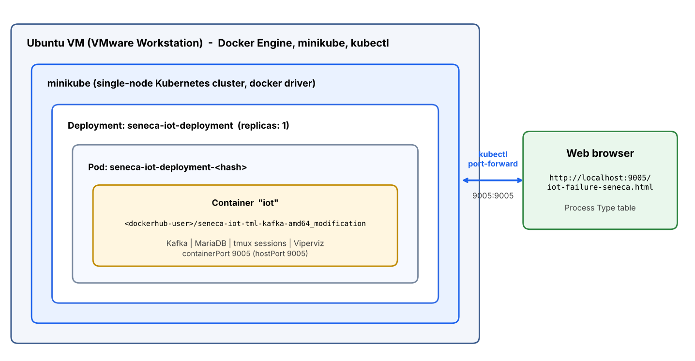

# Kubernetes & Docker TML Dashboard: Custom Preprocess Types on Minikube
A hands-on containers lab that extends the Docker **Transactional Machine Learning (TML)** dashboard. The preprocessing script is modified to apply **MIN, MAX, COUNT, VARIANCE, OUTLIERS and ANOMPROB** to the IoT data stream, the container is rebuilt and pushed to **Docker Hub** with a `_modification` suffix, and it is then deployed on a single-node **Kubernetes** cluster with **minikube** and **kubectl**. Port **9005** is forwarded with `kubectl port-forward` so the dashboard opens in the browser, and the running pod is inspected from the inside with **tmux**.


**Last updated:** November 2026

---

## 📚 Project Objectives
- Change the `preprocesslogic` setting in `preprocess-iot-monitor-customdata.py` to use **MIN, MAX, COUNT, VARIANCE, OUTLIERS and ANOMPROB**
- Build a new container with `_modification` added to its name and push it to **Docker Hub**
- Install **minikube** and **kubectl** and start a one-node Kubernetes cluster with the Docker driver
- Point `senecaiot.yml` at the modified image and create the **Deployment** and **pod** with `kubectl apply`
- Forward host port `9005` to container port `9005` with `kubectl port-forward`
- Open the TML dashboard and show the **Process Type** column in the table
- Go inside the pod with `kubectl exec` / `docker exec`, list the **tmux** sessions, attach to the visualization session, then detach and exit
- Explain what the preprocess types do and why data preprocessing matters ([docs/preprocessing.md](docs/preprocessing.md))

---

## 🗺️ Architecture


---

## 📂 Repository Layout
```
Kubernetes-Minikube-TML-Dashboard-Preprocessing/
├── configs/
│   ├── senecaiot.yml                  # Kubernetes Deployment for the modified image
│   └── preprocess-types.snippet       # The preprocesslogic change
├── diagrams/
│   └── architecture.png               # VM, minikube, pod and port forwarding
├── docs/
│   ├── architecture.md                # Components, ports and design notes
│   ├── preprocessing.md               # What the six preprocess types do
│   ├── setup.md                       # Step-by-step build guide
│   ├── verification.md                # Every check, with expected output
│   └── submission.md                  # Project summary and references
├── screenshots/                       # Proof of each deliverable
├── scripts/
│   ├── install-kubernetes-tools.bash  # Install minikube and kubectl
│   ├── build-container.bash           # Build (and push) the _modification image
│   ├── deploy-to-kubernetes.bash      # Start minikube, apply the YAML, port-forward
│   └── verify-kubernetes.bash         # Optional helper to run the checks
├── .gitignore
└── README.md
```

---

## 🧰 Requirements
- An Ubuntu VM (VMware Workstation) with internet access. The captures show Ubuntu 25.04, Docker 28.1.1 and minikube v1.36.0 (Kubernetes v1.33.1)
- Docker installed (`sudo apt-get install docker.io`) and a free **Docker Hub** account
- The `raspberrypi` repository imported into your GitHub account (see [docs/setup.md](docs/setup.md))
- `minikube` and `kubectl` (installed in the steps below)
- A web browser on the VM (Firefox or Chrome)
- The Docker image from the previous lab, or enough time for a from-scratch build (about 20 minutes)

---

## ⚙️ Setup

Full walkthrough: [docs/setup.md](docs/setup.md). The short version:

1. In your `raspberrypi` repository, edit `iotsolution-scripts-data/preprocess-iot-monitor-customdata.py` and set the preprocess types, then **commit the change** ([configs/preprocess-types.snippet](configs/preprocess-types.snippet)):

   ```python
   preprocesslogic='MIN,MAX,COUNT,VARIANCE,OUTLIERS,ANOMPROB'
   ```

2. Build the new container (with `_modification` in its name) and push it to Docker Hub:

   ```bash
   docker build -t <dockerhub-username>/seneca-iot-tml-kafka-amd64_modification \
     --build-arg CHIP=AMD64 --no-cache --network=host .
   docker login
   docker push <dockerhub-username>/seneca-iot-tml-kafka-amd64_modification
   ```

3. Test the image with Docker and open the dashboard:

   ```bash
   docker run -p 9005:9005 <dockerhub-username>/seneca-iot-tml-kafka-amd64_modification
   ```

   ```
   http://localhost:9005/iot-failure-seneca.html?topic=iot-preprocess2,iot-preprocess&offset=-1&groupid=&rollbackoffset=500&topictype=prediction&append=0&secure=1
   ```

4. Install minikube and kubectl in a `kubernetes` folder:

   ```bash
   mkdir kubernetes && cd kubernetes
   wget https://storage.googleapis.com/minikube/releases/latest/minikube-linux-amd64
   sudo install minikube-linux-amd64 /usr/local/bin/minikube
   curl -LO "https://dl.k8s.io/release/$(curl -L -s https://dl.k8s.io/release/stable.txt)/bin/linux/amd64/kubectl"
   sudo chmod +x kubectl
   sudo install -o root -g root -m 0755 kubectl /usr/local/bin/kubectl
   ```

5. Copy [configs/senecaiot.yml](configs/senecaiot.yml) into the folder and set your image on the `image:` line, then start the cluster and create the pod:

   ```bash
   minikube start --driver=docker
   kubectl apply -f senecaiot.yml
   kubectl get pods
   ```

6. Forward the port (use the pod name from `kubectl get pods`) and open the dashboard URL from step 3:

   ```bash
   kubectl port-forward <pod-name> 9005:9005
   ```

7. In a second terminal, go inside the container and inspect it:

   ```bash
   docker ps
   docker exec -it <container-id> bash
   ls
   tmux ls
   tmux a -t visualization-viperviz-9005     # detach with Ctrl+b, then d
   exit
   ```

---

## ☸️ Kubernetes Deployment

[configs/senecaiot.yml](configs/senecaiot.yml) defines a Deployment with one replica of the modified image:

```yaml
apiVersion: apps/v1
kind: Deployment
metadata:
  name: seneca-iot-deployment
spec:
  selector:
    matchLabels:
      app: iot
  replicas: 1
  template:
    metadata:
      labels:
        app: iot
    spec:
      hostNetwork: true
      containers:
      - name: iot
        image: <dockerhub-username>/seneca-iot-tml-kafka-amd64_modification
        ports:
          - containerPort: 9005
            hostPort: 9005
```

---

## ✅ Usage & Verification

Every check below has expected output and a screenshot in [docs/verification.md](docs/verification.md).

**Start the cluster**

```
$ minikube start --driver=docker
😄  minikube v1.36.0 on Ubuntu 25.04
✨  Using the docker driver based on existing profile
👍  Starting "minikube" primary control-plane node in "minikube" cluster
🏄  Done! kubectl is now configured to use "minikube" cluster and "default" namespace by default
```

**Create the pod and forward the port**

```
$ kubectl apply -f senecaiot.yml
deployment.apps/seneca-iot-deployment unchanged
$ kubectl get pods
NAME                                     READY   STATUS    RESTARTS   AGE
seneca-iot-deployment-844444b687-c5dlz   1/1     Running   3 (6h55m ago)   7d21h
$ kubectl port-forward seneca-iot-deployment-844444b687-c5dlz 9005:9005
Forwarding from 127.0.0.1:9005 -> 9005
Forwarding from [::1]:9005 -> 9005
```

**Inside the container**

```
root@<container-id>:/# tmux ls
kafka: 1 windows
preprocess-data-python-8001: 1 windows
preprocess-data-viper-8001: 1 windows
preprocess2-data-python-8002: 1 windows
preprocess2-data-viper-8002: 1 windows
produce-iot-data-python-8000: 1 windows
produce-iot-data-viper-8000: 1 windows
visualization-viperviz-9005: 1 windows
zookeeper: 1 windows
```

**Dashboard** – the table lists each stream's **Process Type** next to its current value, total messages and Kafka key.

---

## 🔍 How It Works
1. **Preprocess types** – `preprocesslogic` tells the preprocessing script which calculations to run over each sliding time window of the stream. The six types are explained in [docs/preprocessing.md](docs/preprocessing.md).
2. **Rebuild** – The new image carries the changed script. Adding `_modification` to the name keeps it separate from the original image.
3. **Docker Hub** – `docker push` publishes the image so the cluster can pull it by name.
4. **minikube** – A one-node Kubernetes cluster that runs inside a Docker container (`--driver=docker`). It works like a production cluster for this lab.
5. **Deployment and pod** – `kubectl apply -f senecaiot.yml` creates `seneca-iot-deployment`, which keeps one pod of the modified image running and restarts it if it stops.
6. **Port forwarding** – `kubectl port-forward <pod> 9005:9005` connects `localhost:9005` on the VM to the dashboard port in the pod.
7. **Inspection** – The container holds the same tmux sessions as the previous lab, so `tmux ls` and `tmux a -t visualization-viperviz-9005` show the Kafka, preprocessing and visualization services.

---

## 🖼️ Screenshots
| # | Screenshot | File |
|---|------------|------|
| 1 | Preprocess types in `preprocess-iot-monitor-customdata.py` on GitHub | [01-preprocess-types-in-github.png](screenshots/01-preprocess-types-in-github.png) |
| 2 | `senecaiot.yml` with the modified image | [02-senecaiot-yml-deployment.png](screenshots/02-senecaiot-yml-deployment.png) |
| 3 | `kubernetes` folder contents | [03-kubernetes-folder-contents.png](screenshots/03-kubernetes-folder-contents.png) |
| 4 | `minikube start --driver=docker` | [04-minikube-start.png](screenshots/04-minikube-start.png) |
| 5 | `kubectl apply -f senecaiot.yml` | [05-kubectl-apply.png](screenshots/05-kubectl-apply.png) |
| 6 | `kubectl get pods` and `kubectl port-forward` | [06-kubectl-get-pods-port-forward.png](screenshots/06-kubectl-get-pods-port-forward.png) |
| 7 | Modified image on Docker Hub | [07-docker-hub-modification-repository.png](screenshots/07-docker-hub-modification-repository.png) |
| 8 | Dashboard table with the Process Type column | [08-dashboard-process-type-table.png](screenshots/08-dashboard-process-type-table.png) |
| 9 | `docker run` of the modified image | [09-docker-run-modified-image.png](screenshots/09-docker-run-modified-image.png) |
| 10 | `docker ps` | [10-docker-ps.png](screenshots/10-docker-ps.png) |
| 11 | `docker exec`, `ls` and `tmux ls` | [11-docker-exec-ls-tmux-ls.png](screenshots/11-docker-exec-ls-tmux-ls.png) |
| 12 | `tmux a -t visualization-viperviz-9005` | [12-tmux-attach-viperviz-9005.png](screenshots/12-tmux-attach-viperviz-9005.png) |
| 13 | Detach from tmux and exit the container | [13-tmux-detach-and-exit-container.png](screenshots/13-tmux-detach-and-exit-container.png) |

---

## 📖 References
- [Docker Hub](https://hub.docker.com/)
- [smaurice101/raspberrypi – docker folder](https://github.com/smaurice101/raspberrypi/tree/main/docker)
- [smaurice101/raspberrypi – Kubernetes YAML](https://github.com/smaurice101/raspberrypi/blob/main/kubernetes/yaml)
- [smaurice101/raspberrypi – repository](https://github.com/smaurice101/raspberrypi)
- [minikube documentation](https://minikube.sigs.k8s.io/docs/)
- [Install and set up kubectl on Linux](https://kubernetes.io/docs/tasks/tools/install-kubectl-linux/)
- [kubectl port-forward](https://kubernetes.io/docs/tasks/access-application-cluster/port-forward-access-application-cluster/)
