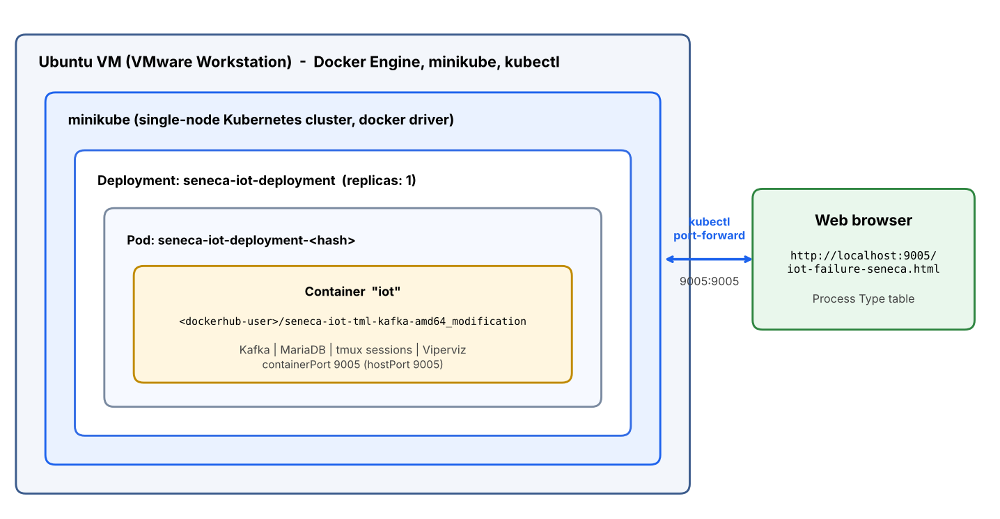

# 🗺️ Architecture

This document describes how the pieces of the lab fit together.

> The diagram is drawn for this repository. The Docker Hub ID is shown as `<dockerhub-user>`.

---

## Components

| Component | Role | Notes |
|-----------|------|-------|
| Ubuntu VM | Host | VMware Workstation, Docker Engine, browser |
| Docker Engine | Builds images, runs minikube | The minikube node is itself a Docker container |
| minikube | One-node Kubernetes cluster | Started with `--driver=docker` |
| kubectl | Cluster command line | Installed in `/usr/local/bin` |
| Deployment `seneca-iot-deployment` | Keeps one pod running | Defined in [`configs/senecaiot.yml`](../configs/senecaiot.yml) |
| Pod / container `iot` | Runs the modified TML image | `<dockerhub-user>/seneca-iot-tml-kafka-amd64_modification` |
| Docker Hub | Image registry | Holds the pushed `latest` tag (about 4.15 GB) |

---

## Ports

| Port | Where | Purpose |
|------|-------|---------|
| 9005 | Pod and VM | Dashboard web page, forwarded by `kubectl port-forward <pod> 9005:9005` |
| 8000 / 8001 / 8002 | Container | Produce, preprocess and preprocess2 sessions |

---

## tmux Sessions in the Container

`zookeeper`, `kafka`, `produce-iot-data-python-8000`, `produce-iot-data-viper-8000`, `preprocess-data-python-8001`, `preprocess-data-viper-8001`, `preprocess2-data-python-8002`, `preprocess2-data-viper-8002` and `visualization-viperviz-9005`.

---

## Design Notes

- **Image name:** The modified image keeps the original repository name and adds `_modification`, so it never overwrites the base image.
- **Replicas:** `senecaiot.yml` asks for one pod. The comment in the upstream file mentions two pods, but the value is `1`.
- **hostNetwork:** The pod uses the node's network (`hostNetwork: true`), and the port is still forwarded with `kubectl port-forward` to reach it from the VM.
- **Version skew:** The captures show `kubectl` 1.31.0 against a Kubernetes 1.33.1 cluster. minikube warns about this but the lab works. Installing the latest `kubectl` (as the install script does) avoids the warning.
- **Pod names change:** The pod name ends in a generated hash, so read it from `kubectl get pods` before every `port-forward` or `exec`.
